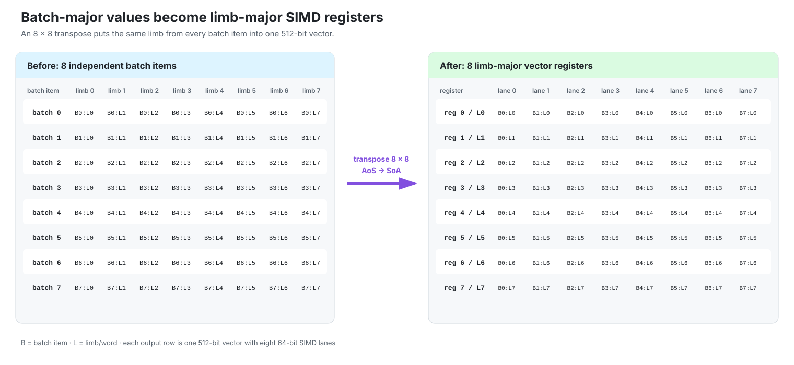

# ed25519-simd

`ed25519-simd` is a verification-only Ed25519 crate focused on high-throughput
batch verification. It verifies signatures and reports the result for each input
element; it does not provide signing APIs or handle private key material.

The implementation is designed to be acceptance-compatible with
[`solana-ed25519`]. The tests include differential checks against
`solana-ed25519` for both supported verification policies and for edge cases
such as small-order points, non-canonical encodings, and scalar-boundary
signatures.

Formal verification of this crate is a work in progress. See the [verification overview](verification/README.md).

## Requirements

**This crate requires 64-bit x86-64 Linux with AVX-512F, BW, DQ, and IFMA.**
Single-signature checks and partial batches also use the AVX-512 IFMA path. The crate fails at compile
time unless the required target features are enabled.
Build with the target CPU enabled, e.g.:

```sh
RUSTFLAGS="-C target-cpu=native" cargo build --release
```

For the throughput reported below, enable whole-program LTO and one codegen
unit in the consuming workspace. Cargo does not apply release-profile settings
from dependency manifests:

```toml
[profile.release]
lto = true
codegen-units = 1
```

Without those settings, verification remains correct but leaves more large
SIMD helpers across call boundaries and is typically a few percent slower.

Doc tests compile through `rustdoc`, so pass the same CPU target there too:

```sh
RUSTFLAGS="-C target-cpu=native" RUSTDOCFLAGS="-C target-cpu=native" cargo test --doc
```

AVX-512 IFMA is available on Intel Ice Lake and later, and on AMD Zen 4 and later.

Because the SIMD path is selected at compile time, **AVX-512 F, BW, DQ, and IFMA
support, including OS support for AVX-512 register state, is a deployment
prerequisite.** A binary built with `-C target-cpu=native` must run on the same
CPU it was built for, or one that is at least as capable. Alternatively, use
explicit `-C target-feature=+avx512f,+avx512bw,+avx512dq,+avx512ifma` flags that match
every deployment host.

The crate performs no runtime CPU-feature detection and has no fallback path.
The target-feature flags apply to the entire binary, not just this crate, so
the compiler may emit AVX-512 instructions in application, dependency, or
standard-library code before any `ed25519-simd` API is called. Running the
binary on a host without the required CPU and OS support may therefore
terminate with an illegal-instruction fault (`SIGILL`) at any point.

Both verification policies use assembly in every build, including
`--no-default-features`. The `asm` feature is retained for compatibility.
The per-routine `verify-asm-*` features check the selected Coq proofs at
build time and embed those routines' certified bytes. The ladder-step proof
checks the wrapper and both call targets after linking. See the
[verification contracts and release audits](verification/README.md).

## Scope

This crate only verifies signatures. Signing is intentionally out of scope:
private key material raises a much stricter implementation bar, especially
around side channels that can leak secret scalar bits through timing, memory
access, or microarchitectural behavior. Verification only handles public inputs,
which makes the crate a narrower and more auditable component.

## Verification Policies

The verifier supports two compile-time policy types:

- `Zip215Policy` (or the `Zip215Verifier` alias) is the default. It performs the ZIP-215 cofactored
  check and accepts non-canonical point encodings according to the
  `verify_zebra` / batch verifier behavior.
- `DalekPolicy` (or the `DalekVerifier` alias) performs the strict Dalek-style
  check: `R` must be canonical, and neither the public key nor `R` may be a
  small-order point.

Both policies reject non-canonical `S` scalars (`S >= L`).

The `Dalek` policy name means "match `solana-ed25519`'s `verify_dalek` entry
point", not "match the `Dalek` row in ed25519-speccheck". Speccheck's Dalek row
describes the acceptance set of the Dalek implementation it tested, which
accepts some small-order and non-canonical edge cases. `solana-ed25519`'s
`verify_dalek` behavior is stricter for this crate's compatibility target: it
requires canonical `R` and rejects small-order public keys and `R` points. The
speccheck fixtures in this repository therefore use speccheck's fixed
expectations for ZIP-215, but use `solana-ed25519` itself as the oracle for the
Dalek policy.

Selecting the policy in the verifier's type lets a normal application contain
only the chosen verification path. If an application truly
needs to select the policy at runtime, `RuntimeVerifier` is an explicit wrapper
that includes both monomorphized implementations.

## Batch Verification

A `Verifier` decodes public keys alongside the signature points and rebuilds their
multiplication tables in reusable scratch space for each SIMD chunk.
Both policies share the read-only basepoint table embedded in the library.

```rust,no_run
use ed25519_simd::{VerifyInput, Zip215Verifier};
# let public_key = [0u8; 32];
# let signature = [0u8; 64];
# let message: &[u8] = b"hello";

let mut verifier = Zip215Verifier::new();

let inputs = [VerifyInput {
    public_key,
    signature,
    message,
}];

let mut out = vec![false; inputs.len()];
verifier.verify_batch(&inputs, &mut out);
// out[0] is true iff `signature` is valid for (public_key, message).
```

Each output entry corresponds to the input at the same index, so callers can see
which signatures passed or failed. `out` must be the same length as `inputs`;
`verify_batch` panics otherwise. Use `DalekVerifier::new()` for the strict policy.

## SIMD Path

The crate batches eight signatures per AVX-512 IFMA chunk. There is no scalar
fallback: single verifications and ragged batch tails are processed as padded
SIMD chunks, and required target features are enforced by the root compile-time
gate (see [Requirements](#requirements)).

Internally, batch data is transposed from eight independent values into
limb-major vectors. Logical register 0 contains limb 0 from batch items 0–7 in
its eight SIMD lanes, register 1 contains limb 1 from the same items, and so on:



This structure-of-arrays layout lets one AVX-512 instruction operate on the
same limb of all eight batch items. The diagram uses an eight-limb value; types
with fewer limbs use the same layout with fewer vectors. The register numbers
are logical array positions—the compiler chooses the physical `zmm` registers.

## Benchmark Snapshot

The following numbers are Criterion estimates in microseconds per signature for
distinct-key batches.

All rows were measured on an AMD EPYC 9555P with rustc 1.95.0, pinned to CPU 4.
The comparison uses `solana-ed25519` 0.2.4. Criterion used its default 3-second
warm-up, 5-second measurement target, and 100 samples.

The comparison benches live in the `benches-compare` workspace member. Each
policy has a self-only executable (`zip215_cold_self` or `dalek_cold_self`).
The `zip215_cold` and `dalek_cold` executables retain the full comparison matrix.
These commands refresh this crate's distinct-key rows:

```sh
cd benches-compare
for bench in zip215_cold_self dalek_cold_self
do
  for filter in \
    'distinct_keys/msg_len_1/ed25519_simd' \
    'distinct_keys/msg_len_1024/ed25519_simd' \
    'distinct_keys/msg_len_mixed/ed25519_simd'
  do
    taskset -c 4 env \
      RUSTFLAGS="-C target-cpu=native -C target-feature=+avx512f,+avx512bw,+avx512dq,+avx512ifma" \
      cargo bench --bench "$bench" -- \
        "$filter" --noplot --discard-baseline
  done
done
```

Message length 1:

| Backend | 8 | 16 | 32 | 64 |
|---|---:|---:|---:|---:|
| ed25519-simd Zip215 | 2.92 | 2.92 | 2.92 | 2.92 |
| ed25519-simd Dalek | 2.92 | 2.94 | 2.94 | 2.92 |
| solana-ed25519 Zip215 batch[^batch-api] | 13.22 | 12.23 | 11.77 | 11.55 |
| solana-ed25519 Dalek loop | 23.59 | 23.55 | 23.57 | 23.57 |
| ed25519-dalek batch[^batch-api] | 14.30 | 13.24 | 12.66 | 12.42 |
| ed25519-dalek loop | 20.19 | 20.15 | 20.16 | 20.16 |
| aws-lc-rs parsed loop | 22.62 | 22.59 | 22.61 | 22.61 |
| ring loop | 30.67 | 30.58 | 30.59 | 31.57 |
| sodiumoxide loop | 35.58 | 35.48 | 35.48 | 35.51 |
| openssl loop | 59.30 | 58.85 | 58.80 | 59.12 |

Message length 1024:

| Backend | 8 | 16 | 32 | 64 |
|---|---:|---:|---:|---:|
| ed25519-simd Zip215 | 3.11 | 3.13 | 3.12 | 3.12 |
| ed25519-simd Dalek | 3.11 | 3.11 | 3.11 | 3.11 |
| solana-ed25519 Zip215 batch[^batch-api] | 14.15 | 13.13 | 12.69 | 12.56 |
| solana-ed25519 Dalek loop | 24.52 | 24.59 | 24.59 | 24.62 |
| ed25519-dalek batch[^batch-api] | 15.22 | 14.17 | 13.61 | 13.37 |
| ed25519-dalek loop | 21.08 | 21.16 | 21.16 | 21.19 |
| aws-lc-rs parsed loop | 23.74 | 23.73 | 23.73 | 23.72 |
| ring loop | 31.59 | 31.65 | 31.67 | 32.70 |
| sodiumoxide loop | 36.57 | 36.67 | 36.73 | 36.81 |
| openssl loop | 59.90 | 59.87 | 60.04 | 60.39 |

Mixed message lengths:

| Backend | 8 | 16 | 32 | 64 |
|---|---:|---:|---:|---:|
| ed25519-simd Zip215 | 2.97 | 2.96 | 2.97 | 2.96 |
| ed25519-simd Dalek | 2.97 | 2.96 | 2.97 | 2.95 |
| solana-ed25519 Zip215 batch[^batch-api] | 13.31 | 12.30 | 11.87 | 11.65 |
| solana-ed25519 Dalek loop | 23.65 | 23.73 | 23.73 | 23.74 |
| ed25519-dalek batch[^batch-api] | 14.51 | 13.40 | 12.88 | 12.61 |
| ed25519-dalek loop | 20.22 | 20.29 | 20.30 | 20.30 |
| aws-lc-rs parsed loop | 22.77 | 22.80 | 22.81 | 22.78 |
| ring loop | 30.54 | 30.70 | 30.70 | 31.67 |
| sodiumoxide loop | 35.42 | 35.61 | 35.62 | 35.68 |
| openssl loop | 58.63 | 59.24 | 59.11 | 59.18 |

[^batch-api]: The batch APIs for `solana-ed25519` and `ed25519-dalek` return a
    single pass/fail result for the whole batch. They do not identify exactly
    which signatures in the batch were invalid.

### Hot Key Repeats

To rerun only this crate's hot-key cases:

```sh
cd benches-compare
for bench in zip215_cold_self dalek_cold_self
do
  taskset -c 4 env \
    RUSTFLAGS="-C target-cpu=native -C target-feature=+avx512f,+avx512bw,+avx512dq,+avx512ifma" \
    cargo bench --bench "$bench" -- \
      'hot_keys/distinct_4/ed25519_simd' --noplot --discard-baseline
done
```

This scenario cycles through 4 distinct keys to fill each batch and reuses
the same `Verifier` across benchmark iterations.

| Backend | 8 | 16 | 32 | 64 |
|---|---:|---:|---:|---:|
| ed25519-simd Zip215 | 2.93 | 2.92 | 2.91 | 2.91 |
| ed25519-simd Dalek | 2.92 | 2.92 | 2.92 | 2.92 |

## Compatibility Target

Compatibility with [`solana-ed25519`] is a design constraint, not just a
benchmark target. The benchmark compares throughput against `solana-ed25519`,
while the tests compare accept/reject decisions against the matching verifier
entry points.

[`solana-ed25519`]: https://crates.io/crates/solana-ed25519
